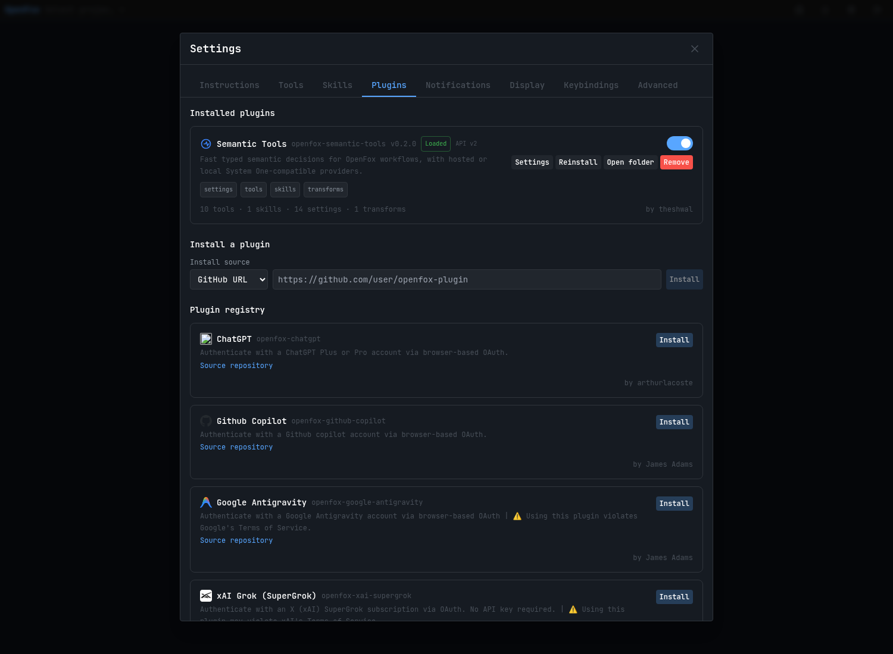
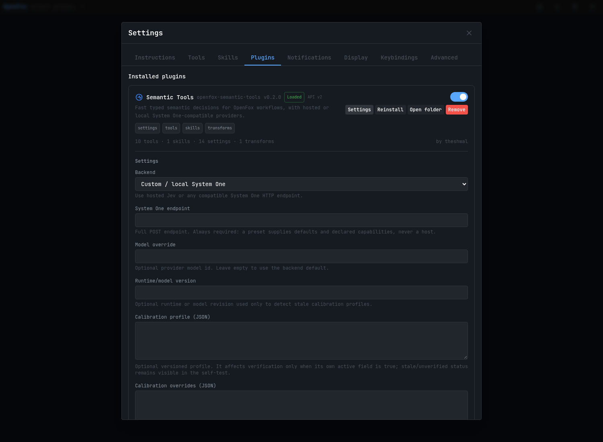

# openfox-semantic-tools

Typed semantic decisions for [OpenFox](https://github.com/co-l/openfox), against
any System One-compatible endpoint — hosted or local.

Instead of spending a large generative model to answer small bounded questions
("does this change satisfy criterion X?", "which of these regions is relevant?"),
this plugin asks a small decision model and returns typed probabilities that
ordinary code can consume.

```
noul    yes / no, with a probability
choice  one of your labels, with a distribution
score   a position on an ordered rubric, with a distribution
```

> **What this is not.** It is not a cheaper main model, and it does not replace
> tests, typechecks, linters or human review. Every tool here is **advisory**:
> none of them can mark a task complete or merge-safe. See
> [What it will never do](#what-it-will-never-do).



<sub>Settings → Plugins on OpenFox 2.0.161, captured against a throwaway instance.</sub>

---

## Tested with

You asked whether this actually works, and with what. Here is exactly what was
run, against **real** semantic runtimes, and what came back.

### Protocol conformance — three real runtimes

`npm run conformance` against each runtime, scored against the documented
System One protocol:

| Runtime | Result | Deviation found |
| --- | --- | --- |
| **Laya-compatible** (self-hosted) | `compatible: true`, `strictCompatible: true`, 11/11 cases | none |
| **Hosted Jev** (`jev-latest`, runtime reported `jev-1.13.0`) | reachable, single deviation | rejects `choice` with **array** criteria; object-map criteria work |
| **Kev** (local, `kev-latest`) | 9/11 cases | same array-criteria rejection **plus** it accepted a malformed wire payload |

The array-criteria deviation is not worked around in the transport: it is
recorded as a **declared capability** on the preset, and only that preset's
requests are rewritten. `Kev` stays `unverified` even though it showed the same
deviation, because its run was incomplete — an incomplete observation is not a
clean one.

### Verification behaviour — the honest, unflattering result

`npm run verify:experiment -- --live`, 41 labelled cases per runtime:

| Runtime | Cases matching the expected status |
| --- | --- |
| Jev | 25/41 |
| Kev | 17/41 |
| Laya | 6/41 |

**Read this as a negative finding, not a quality score.** The expectation set
spans statuses the uncalibrated policy cannot emit, and on these runs
**no runtime ever produced a positive status** (`observedPositiveStatuses` is
empty for all three). The plugin was designed for exactly that outcome: with
`calibrated: false` it cannot confirm a criterion, so a disagreeing answer
degrades to `unknown` or a follow-up rather than to a false "done". Zero
transport failures across all 123 live calls.

These are **not** new measurements and **not** a ranking. They are the dated
snapshot already recorded in [#9](https://github.com/theshwal/openfox-semantic-tools/issues/9),
reproduced here so a reader knows the plugin was exercised against real
runtimes. No run was added while writing this file, no runtime is preferred,
and no default provider is implied — `custom` remains the default preset.

Full observations: [docs/LIVE-JEV-FINDINGS.md](docs/LIVE-JEV-FINDINGS.md).
The underlying measurement is tracked in [#9](https://github.com/theshwal/openfox-semantic-tools/issues/9).

### The plugin itself

| Check | Result |
| --- | --- |
| Loaded by a real OpenFox **2.0.161** | 23/23, including host-reported `messageTransforms=1` |
| Protocol against an offline stub | 13/13 cases, 0 deviations |
| Typecheck, build, contract tests | 470 pass, 0 fail |

Reproduce all of it, offline and without spending anything:

```bash
npm run verify:local
```

That command runs every automatic check and then prints exactly which steps
remain manual.

---

## Install

Requires **OpenFox 2.0.161 or later** and **Node 24+**.

```bash
git clone https://github.com/theshwal/openfox-semantic-tools.git
cd openfox-semantic-tools
npm ci --ignore-scripts
npm run build
```

In OpenFox: **Settings → Plugins → install from local path**, and give the
absolute path (it must start with `/`). Then enable it.

**→ In a hurry? [docs/QUICKSTART.md](docs/QUICKSTART.md)** — the same steps in
five minutes, ending with a first `semantic_decide` call.

Installing the packed `.tgz` does not work — it ships no `tsconfig.json`, so the
host's build step fails. The full explanation is in
[docs/INSTALLATION.md](docs/INSTALLATION.md).

**→ Full instructions, settings reference, troubleshooting:
[docs/USER-GUIDE.md](docs/USER-GUIDE.md).**

---

## Settings

Everything is configured in the plugin's own panel. Nothing is guessed for you.

| Setting | Required | Default | What it does |
| --- | --- | --- | --- |
| `backend` | no | `custom` | Selects a provider preset. A preset supplies **defaults and declared capabilities, never a host**. |
| `endpoint` | **yes** | *(empty)* | The full POST URL of a System One-compatible runtime, e.g. `https://example.com/v1/systemone`. Empty means every tool fails with a clear message, by design. |
| `model` | no | *(backend default)* | Provider model id. A value you type always wins over the preset's. |
| `apiKey` | no | *(empty)* | Secret. Only needed if your endpoint requires one. Never logged, never returned in clear text. |
| `runtimeVersion` | no | *(empty)* | An operator-typed label for your runtime. **Purely descriptive** — nothing verifies it. |
| `calibrationProfileJson` | no | *(empty)* | An installed, measured calibration profile. Absent by default; see below. |
| `calibrationOverridesJson` | no | *(empty)* | Manual gate overrides. Same caution. |
| `timeoutMs` | no | `5000` | Maximum duration of one provider request (1–120000). |
| `endpointClass` | no | `auto` | `auto` / `local` / `private` / `remote`. Forces the classification when auto-detection is wrong. |
| `egressPolicy` | no | `allow` | `allow`, `block-remote-automatic`, or `block-remote-all`. See below — **read this one**. |
| `cacheEnabled` | no | `false` | Reuse an identical previous answer. Only successful answers are ever reused, never an error. |
| `cacheTtlMs` | no | `300000` | How long a cached answer may be reused. `0` disables reuse. |
| `cacheMaxEntries` | no | `128` | Hard bound, oldest-first eviction. |
| `confidenceThreshold` | no | `75` | Your confidence dial, in percent. Labels each discovery candidate `above` or `below`. **It only labels** — see below. |
| `contextReduce` | no | `false` | Experimental context reduction. **No measured benefit — leave it off.** See below. |
| `activityPanel` | no | `true` | A "Semantic activity" panel opened from the Plugins menu. In-memory only; reports observed usage, never a quality claim. See below. |
| `activityLocale` | no | `auto` | Language of the panel's table rows. Every other label follows the OpenFox interface on its own; only a table has to be told. |



<sub>The settings form rendered by the host from this plugin's schema — every
field carries its own explanation, so nothing has to be looked up elsewhere.</sub>

### `egressPolicy` — decide this before pointing at a remote host

| Value | Effect |
| --- | --- |
| `allow` | Anything may be sent, including repository-derived content. This is the default. |
| `block-remote-automatic` | **Explicit** tool calls still work; automatic ones (code discovery, context reduction) are blocked for remote hosts. **Recommended.** |
| `block-remote-all` | Nothing reaches a remote host, even when you ask. |

The setting only ever *blocks*, so switching it later can never surprise you by
sending more. Discovery and verification always mark their calls as
`automatic`; `semantic_decide` is `explicit` because you called it yourself.

### `confidenceThreshold` — your dial, not a verdict

Every discovery result carries a **relevance envelope**: what was looked
at, what was **not** looked at (named one by one, with the reason), what
the number is worth, and what it does **not** guarantee. The fourth part is
fixed text on every result, because a reader who sees it twice must be
able to trust it twice.

Your dial then labels each candidate `above` or `below`. It has three
properties that are enforced by tests, not by convention:

- **It only labels.** A below-threshold candidate stays in the list,
  marked. Nothing is filtered away from you.
- **It cannot promote.** A missing, unusable or failed answer stays
  `unknown`, whatever the dial says. Set it to 0 and a broken answer is
  still not a pass.
- **It is read on every call.** Change it and the next tool call uses the
  new value; nothing to reload.

At the 75% default you will see more `below` than you might expect, and
that is the point: it pushes the agent to confirm a candidate instead of
trusting it. Lower it if you want a shorter list.

The number it labels is a **provider confidence** — how concentrated the
model's distribution was over its own answer. It is **not** a measured
probability that the file is correct, no ground-truth check backs it, and
nothing here has been calibrated. That is stated on every single result.

### `contextReduce` — experimental, and honestly negative

OpenFox 2.0.161 added `registerMessageTransform`, so the plugin now offers an
optional transform that asks the provider which earlier messages are no longer
needed before each LLM call.

It is **off by default**, and the recorded verdict in
[docs/EVALUATION.md](docs/EVALUATION.md) is **DEFER**. Token arithmetic and
provider cost were measured; task quality was **not**, and that is the axis that
matters. A smaller prompt that makes the model rediscover what you removed is a
loss, and nothing here establishes that it is a win.

If you enable it anyway: use `semantic_transform_status` to see what it actually
did. Every outcome carries a reason (`no_candidates`, `low_confidence`,
`egress_blocked`, …), so a no-op is never silent. It never drops the current
request or anything after the last tool result.

### `activityPanel` — showing how the semantic tools were used

On by default, this adds a **Semantic tools** section to the OpenFox Stats
panel for the current session.

It reports what the plugin can actually prove about its own calls: how many
there were, how long the provider took, how many answers came back unusable
(no candidate carried a score, or the provider returned an unusable
distribution), and how many times the same question was asked twice — which is
a **proven** sign the first attempt did not settle anything. Questions are never
kept: each one is reduced to a short digest, so a repeat is visible without the
wording being stored.

Every line states its own proof level: `[proven]` for something the plugin
established itself, `[reported status]` for a number copied from a report, and a
separately-counted `heuristic, unproven` bucket for the one guess it makes.

It does **not** show a "share of tool calls" ratio: that denominator lives in
the host's session stats, and this panel reports only what the plugin observed
about its own calls. It shows each tool's share of the *semantic* calls made in
the session — a real number, with a real denominator, named once in the
section's closing note rather than repeated on every row.

The wider session total is observable separately: the plugin subscribes to
`tool.completed` through the read-only hook surface, and `semantic_hook_status`
reports what arrived. Those counts are the host's, reported by us, and are never
merged with the panel's own numbers.

What it deliberately does not do is claim the semantic path is better. A call
with no evidence either way is reported as **indeterminate**, never as "useless".
Measuring that would need a deterministic control group, which nobody is going to
pay for twice.

Everything stays **in memory**, is bounded, and is discarded with the session:
nothing is written to disk and nothing is sent anywhere. Turn `activityPanel`
off and nothing is recorded at all — not recorded and hidden, simply not
recorded.

Open it from the Plugins menu (puzzle icon, top right). It is scoped to the
session you are looking at, and its numbers reflect the moment it was opened.

---

## Tools

| Tool | Purpose | Can it conclude? |
| --- | --- | --- |
| `semantic_decide` | One state, several batched `noul`/`choice`/`score` questions. | No — it returns probabilities. |
| `semantic_verify_task` | One acceptance criterion against bounded evidence. | No — cannot mark anything satisfied while uncalibrated. |
| `semantic_issue_coverage` | Several criteria against one task/evidence block. | No — coverage and follow-ups only. |
| `semantic_search` | Find code from a query; bounded local recall, then reranking. | No — ranked candidates. |
| `semantic_scan` | Score an explicit file list against a behavioural predicate. | No — ranked candidates. |
| `semantic_provider_self_test` | Synthetic smoke test of your endpoint. Free. | No — never changes settings. |
| `semantic_transform_status` | What the optional transform did, and why. | No — a pure reader. |
| `semantic_hook_status` | Which host events the plugin observed, and which data keys arrived. | No — a pure reader. |
| `semantic_calibration_candidate` | Turn your labelled cases into an inactive profile. | No — never activates anything. |
| `semantic_question_calibration` | Score one question against your cases. | No — never sets a threshold. |
| `semantic_reference_agreement` | Compare the provider to your reference judgments. | No — never ranks providers. |
| `semantic_usage_report` | How often each skill was offered and each capability invoked. | No — bookkeeping only, contacts nothing. |

Registering a tool does **not** grant access. Add it to the agent's
`allowedTools` (Settings → Agents), or the agent cannot call it.

---

## Skills

The plugin ships two skills that teach an agent *when* to use these tools and
*when not to*. They are guidance only — a skill never grants tool access.

| Skill | Teaches |
| --- | --- |
| `semantic-verification` | When a bounded semantic check on one acceptance criterion is worth running after the deterministic checks, how to read each status, and when to fall back to the normal verifier. |
| `semantic-code-discovery` | When `semantic_search` / `semantic_scan` actually reduce exploration, and when grep, symbols or a failing test already answer the question. |

Both are deliberately provider-neutral: they contain no provider name,
endpoint, URL or model id, and both state that tests, typechecks, linters and
human review stay mandatory.

An observed host behaviour worth knowing: a plugin tool is permission-checked
only when the agent's `allowedTools` names at least one non-builtin tool. An
agent restricted to builtins only is not restricted from plugin tools at all.

---

## What it will never do

These are guarantees, enforced by tests:

- Never replaces tests, typechecks, linters or human review.
- Never marks a task complete or merge-safe.
- Never branches a workflow on a semantic result — no transition handler is
  registered. The read-only hooks it does subscribe to are not a gate: a
  `PluginHookHandler` **returns void**, so there is no channel through which a
  plugin could accept, refuse or alter a turn.
- Never blocks a turn; a transform cannot veto one.
- Never deletes the current request or anything after the last tool result.
- Never turns a provider error, timeout or malformed answer into a positive
  result. It becomes a structured failure.
- Never logs or echoes an API key, and never reflects an upstream error body.
- Never follows a redirect.
- Never sends repository content anywhere without an endpoint you configured and
  a policy that allows it.

---

## Honest limits

- **No quality certification exists.** The live runs above are dated
  observations, not a benchmark.
- **No saving is claimed** — no token, cost, latency or quality figure, because
  none has been measured. Unmeasured fields are recorded as `null`, never `0`.
- **No provider is endorsed.** `custom` is the default preset and stays that
  way. A preset's capabilities are *declared* from real conformance runs;
  `unverified` means nobody asked, never "it works".
- **The calibration layer ships inactive.** Until you install a measured
  profile, verification cannot emit a positive verdict. That is deliberate.

---

## Further reading

| Document | For |
| --- | --- |
| [docs/QUICKSTART.md](docs/QUICKSTART.md) | Five minutes from clone to a first call. |
| [docs/USER-GUIDE.md](docs/USER-GUIDE.md) | Operating the plugin: install, settings, tools, skills, troubleshooting. |
| [docs/INSTALLATION.md](docs/INSTALLATION.md) | Install recipes, and why the tarball fails. |
| [docs/PROVIDERS.md](docs/PROVIDERS.md) | The System One protocol, presets and capabilities. |
| [docs/EVALUATION.md](docs/EVALUATION.md) | What counts as success, and every recorded verdict. |
| [docs/CALIBRATION.md](docs/CALIBRATION.md) | Building and installing a calibration profile. |
| [docs/ARCHITECTURE.md](docs/ARCHITECTURE.md) | Internal design and the module map. |
| [docs/TRACEABILITY.md](docs/TRACEABILITY.md) | Every requirement mapped to the file and test that proves it. |
| [docs/IMPLEMENTATION.md](docs/IMPLEMENTATION.md) | Harness results, release state, what remains. |
| [docs/LIVE-JEV-FINDINGS.md](docs/LIVE-JEV-FINDINGS.md) | The bounded live run, including what it found. |

## Licence

MIT. See [LICENSE](./LICENSE).
